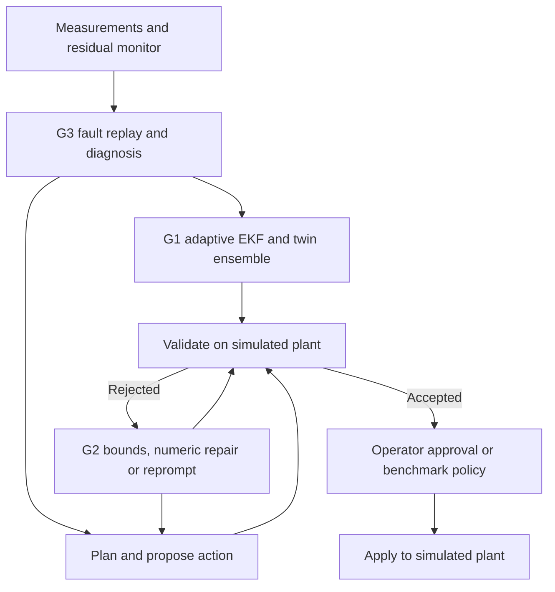

# EMI-RAPL Thermal

**Physics-grounded LLM agents for fault-tolerant control of a multi-zone thermal process.**
AI4015 Agentic AI semester project. Seed G3-09, *EMI-RAPL: Trustworthy Mechatronics and Robotics Intelligence through
Reasoning Agentic LLMs and Physics-Informed Learning* (supervisor: Naeem Tareen).

LLM agents supervise PI-controlled heater zones (a TCLab two-heater board, plus a four-zone furnace chain). When a
fault is detected, a Planning Agent picks a recovery mode and an Action Agent proposes setpoints, gains, output
limits or sensor offsets. Every proposal is simulated on a digital twin and checked by a deterministic validator
before it can touch the plant. Success is always judged on the **hidden true plant**, never on the twin.

The baseline re-implements the workflow of the base paper:

> J. Vyas, M. S. Gill, A. Markaj, F. Gehlhoff, M. Mercangöz, "From detection to action: Using LLM agents for
> fault-tolerant control," *Journal of Process Control*, vol. 167, 103855, 2026.

See [docs/base_paper_mapping.md](docs/base_paper_mapping.md) for the component-by-component mapping, and
[docs/architecture.png](docs/architecture.png) for the architecture (gaps G1–G3 marked).

## Quick start

```bash
# Python 3.10+; uv is optional (plain pip works too)
uv venv .venv && uv pip install -e ".[dev]"      # or: python -m venv .venv && .venv/Scripts/pip install -e ".[dev]"
.venv/Scripts/python -m pytest -q                 # tests run without an API key
```
On Linux/macOS, use `.venv/bin/python` wherever these commands say `.venv/Scripts/python`.


Offline run (no API key): non-LLM baselines on the 120-scenario suite:

```bash
.venv/Scripts/python scripts/run_eval.py --methods no_recovery rule_table de_retune --run phase1_nonllm
```

LLM run: copy `.env.example` to `.env` and add a free Groq key (https://console.groq.com/keys). Groq applies organisation-level quotas. After a quota pause, rerun the same command once capacity is available:

```bash
.venv/Scripts/python scripts/run_eval.py --provider groq --model openai/gpt-oss-20b \
    --suite configs/suites/phase1_llm_subset.json \
    --methods single_llm base_agent_matched base_agent_nominal --run phase1_llm_gptoss20b
.venv/Scripts/python scripts/run_eval.py --provider groq --model openai/gpt-oss-120b \
    --suite configs/suites/phase1_llm_subset.json \
    --methods single_llm base_agent_matched base_agent_nominal --run phase1_llm_gptoss120b
```
Check the model names against your provider's current free-tier list; model availability changes.

Results land in `results/<run>/`: `summary.csv` (one row per episode), `aggregate_by_method*.csv`, and
`episodes.jsonl` (full decision traces: prompts' outputs, validations, token counts). Runs resume where they
stopped. Run `python scripts/make_report.py` to rebuild the tables and figures in `docs/results/`.

Inspect a single decision (plan → action → twin validation → reprompts → true-plant outcome):

```bash
.venv/Scripts/python scripts/show_trace.py --run phase1_llm_gptoss20b --list
.venv/Scripts/python scripts/show_trace.py --run phase1_llm_gptoss20b --scenario p1-z2-sensor_bias-mm20-s1 --method base_agent_nominal
```

## What is in the box

| Path | Purpose |
|---|---|
| `src/emirapl/env/thermal.py` | N-zone TCLab energy-balance plant (convection, radiation, inter-zone coupling, sensor lag), RK4 |
| `src/emirapl/env/faults.py` | 5 fault types: heater degradation, enclosure heat loss, local insulation loss, sensor bias, stuck-high heater |
| `src/emirapl/env/episode.py` | episode timeline (warm-up → fault → detect → decide → apply) and true-plant metrics |
| `src/emirapl/control/pid.py` | per-zone PI loops with anti-windup and output limits |
| `src/emirapl/agents/monitor.py` | residual-based detection; oracle localisation (base-paper assumption) |
| `src/emirapl/agents/pipeline.py` | **base-paper agent**: plan → act → twin validation → reprompt (≤5) → fallback |
| `src/emirapl/tools/twin.py` | matched and nominal base-paper digital twins |
| `src/emirapl/agents/phase2.py` | measurement-only diagnosis, calibrated ensemble, numeric repair and approval gate |
| `src/emirapl/tools/validator.py` | admissibility, ranges, safety envelope, regulation, shutdown justification |
| `src/emirapl/knowledge.py` | plant knowledge graph, mode FSM, constraints |
| `src/emirapl/contracts.py` | pydantic contracts for all agent I/O and traces |
| `src/emirapl/llm/` | OpenAI-compatible client (Gemini / Groq / Ollama / OpenAI), rate limiting, retries, token accounting; scripted client for offline tests |
| `src/emirapl/baselines/` | `no_recovery`, `rule_table`, `single_llm`, `de_retune` |
| `configs/suites/` | evaluation suites (`phase1_suite.json`: 5 faults × 2 plants × 4 mismatch levels × 3 seeds = 120) |
| `tests/` | unit + end-to-end tests |

## Methods compared

| Name | Description |
|---|---|
| `no_recovery` | PI loops left unchanged |
| `rule_table` | fixed fault-type → action table with nominal magnitudes (deterministic workflow) |
| `single_llm` | one LLM call, action applied without simulation or validation |
| `de_retune` | differential evolution over derate, PI gains and sensor offset on the nominal twin (no LLM) |
| `base_agent_matched` | base-paper workflow, twin = exact plant copy (the paper's evaluation assumption) |
| `base_agent_nominal` | base-paper workflow, twin = nominal model + fault label (realistic deployment) |

The `scripted` provider is a deterministic rule-based stand-in for the LLM. It exercises the full pipeline
offline and in CI. Its numbers are a pipeline check, not an LLM result.

## Phase-1 submission

The submitted document is [phase1/Phase1_G3-09_23I-0746.pdf](phase1/Phase1_G3-09_23I-0746.pdf) (Word source and
build scripts in `phase1/`).

## Phase-1 results (summary)

Full 120-scenario suite. The base workflow uses a scripted proposer, so the two twins see identical proposals:

| Method | Plant success | Validated-but-failed |
|---|---|---|
| No recovery | 19.2 % | – |
| Rule table | 67.5 % | – |
| DE retune (nominal twin) | 65.0 % | – |
| Base workflow, matched twin (paper's assumption) | 80.8 % | **0.0 %** |
| Base workflow, nominal twin (realistic) | 80.8 % | **19.2 %** |

A realistic twin approves about one action in five that then fails on the true plant, mostly under sensor bias. This is
the gap that G1 targets. Real-LLM runs (gpt-oss-20b / gpt-oss-120b on Groq, 66 episodes on a 10-scenario core set
covering all five faults) show a single unvalidated LLM call succeeding in only 27–42 % of episodes, sometimes unsafely.
The validated workflow keeps the plant safe (90–100 %), but the LLM itself finds a valid action in only 60–73 % of
episodes and leans on the fallback (G2). Full tables and figures are in [docs/results/](docs/results/phase1_results.md).

## Phase 2 supervisor



### Changes since Phase 1

The supervisor uses measurement-only fault replay, a covariance ensemble around an
adaptive EKF, and bounded repair of derates and sensor offsets. The terminal demo
shows the exact selected action before approval. Validation checks every ensemble
member and requires the empirical p95 peak to stay at or below 60 °C. Replay fits
single-fault hypotheses, including on the compound stress suite. The Phase 1
baseline methods and original results are retained for historical reference.

### Install and run the demo

Use Python 3.10 or newer. On Windows, open PowerShell in the extracted folder
containing `pyproject.toml` and run these commands.

```powershell
py -3 -m venv .venv
.\.venv\Scripts\python.exe -m pip install -e ".[dev]"
.\.venv\Scripts\python.exe -m pytest -q
.\.venv\Scripts\python.exe scripts\phase2_demo.py
```

On Linux or macOS, create the environment with `python3 -m venv .venv` and
use `.venv/bin/python` in place of the Windows executable. The optional
`.[dev,fast]` extra installs Numba on supported platforms and speeds up
simulation. Pick the environment before starting an evaluation. Keep it
consistent across the two live runs and their resumes.

The demo runs with scripted replies and saves `results/_demo.json`. Enter `y`
to apply the displayed action in the simulator or press Enter to decline it.

### Run the live evaluation

Use fresh output folders for this revision. In PowerShell, open the project’s
local configuration and fill in the `GROQ_API_KEY=` line. An existing PowerShell
environment variable takes precedence over the value in `.env`.

```powershell
if (-not (Test-Path .env)) { Copy-Item .env.example .env }
notepad .env
```

Save the file and check both models with one short request each.

```powershell
.\.venv\Scripts\python.exe experiments\run_phase2.py --provider groq --model openai/gpt-oss-20b --preflight
.\.venv\Scripts\python.exe experiments\run_phase2.py --provider groq --model openai/gpt-oss-120b --preflight
```

After preflight passes, run the two commands in order. Each covers 20 fixed
scenarios, 11 methods and three repeats, or 660 episodes per model. The price
flags use uncached list rates in USD per million tokens. The resulting
`estimated_cost_usd` is an estimate for reported usage. Treat missing usage
counts, any cached input discounts and your actual billing separately.

[Groq 20B model rates](https://console.groq.com/docs/model/openai/gpt-oss-20b)
and [Groq 120B model rates](https://console.groq.com/docs/model/openai/gpt-oss-120b)

```powershell
.\.venv\Scripts\python.exe experiments\run_phase2.py --experiment all --split llm --provider groq --model openai/gpt-oss-20b --input-price 0.075 --output-price 0.30 --out results\phase2_final_v3_20b
.\.venv\Scripts\python.exe experiments\run_phase2.py --experiment all --split llm --provider groq --model openai/gpt-oss-120b --input-price 0.15 --output-price 0.60 --out results\phase2_final_v3_120b
```

The terminal prints the saved count. After Ctrl+C, a connection interruption or
a quota pause, rerun the **same command**. The runner retains verified episodes
and resumes with the unfinished one. Provider interruptions can span multiple
quota windows. See [Groq rate limits](https://console.groq.com/docs/rate-limits).

Use results when `completion.json` shows `"status": "complete"` and the counts
match. The analysis checks the exact scenario, method and repeat grid. Run:

```powershell
.\.venv\Scripts\python.exe experiments\analyze_phase2.py results\phase2_final_v3_20b
.\.venv\Scripts\python.exe experiments\analyze_phase2.py results\phase2_final_v3_120b
```

Each run folder contains the manifest, per-episode decisions and metrics,
per-repeat results, means and sample standard deviations, failure counts,
representative traces, `safety_outcomes.csv` and gap analysis. The safety table reports both the original post-actuation outcome and the stricter result from fault onset. The G2 analysis reports repair attempts and validated repairs separately from reprompt recovery. The provider observations record
returned model versions, fingerprints when supplied, and usage coverage.

### Reproduce experiments and offline results

Use the virtual environment Python for these commands. The experiment selector
also accepts E1, E2, E3, E4, E5 and E6 individually. E1 covers simple baselines,
E2 covers the base-paper workflow, E3 runs the full agent, E4 covers the
gap-specific comparisons, E5 runs the three ablations, and E6 collects
efficiency and reliability metrics. Use one worker for timing comparisons.

```bash
python experiments/run_phase2.py --experiment all --split test --workers 8 --out results/reproduce_test
python experiments/analyze_phase2.py results/reproduce_test
python experiments/run_phase2.py --experiment all --split llm --workers 4 --out results/reproduce_core
python experiments/analyze_phase2.py results/reproduce_core
python experiments/run_phase2.py --experiment E4 --split screen --workers 4 --out results/reproduce_screen
python experiments/analyze_phase2.py results/reproduce_screen
python experiments/run_phase2.py --experiment E3 --split stress --workers 2 --out results/reproduce_stress
```

The packaged `results/phase2_final_*` scripted runs are offline evidence. The
earlier Phase 2 runs are historical. Use live results for claims about the two
LLMs. The verification used simulated HTTP responses to exercise the live CLI
and error handling.

### Gap resolution on the scripted screen

The table uses the 20 scenarios in
[`results/phase2_final_screen_scripted`](results/phase2_final_screen_scripted).
G1's 30% mismatch subset contains 10 scenarios. G2's reprompt recovery was 0/2
for the nominal baseline and 0/4 for the full supervisor.

| Gap | Component | Metric | Local base-paper workflow | Full supervisor | Addressed on the screen |
|---|---|---|---|---|---|
| G1 | Adaptive EKF and ensemble | Validated-but-failed / plant success at 30% mismatch | 10% / 90%, nominal twin | 50% / 40% | No |
| G2 | Physics bounds and seeded repair | Recovery after reprompt / mean reprompts | 0% / 0.50 | 0% / 1.00 | Live hypothesis pending |
| G3 | Replay and verified diagnosis | Correct kind and zone / plant success | 100% by oracle / 90%, with 10% plant success without oracle | 75% / 60% | Partial |

The local comparison uses the same scenarios and metrics for all methods.
Published CSTR and mixer numbers describe a different environment. See the
[evaluation protocol](docs/phase2_protocol.md), [development log](docs/devlog.md),
and [historical screening findings](docs/phase2_findings.md).

## Team
- Fatima Khursheed (23I-0746), group head
- Saleha Muhammad (23I-0727)
